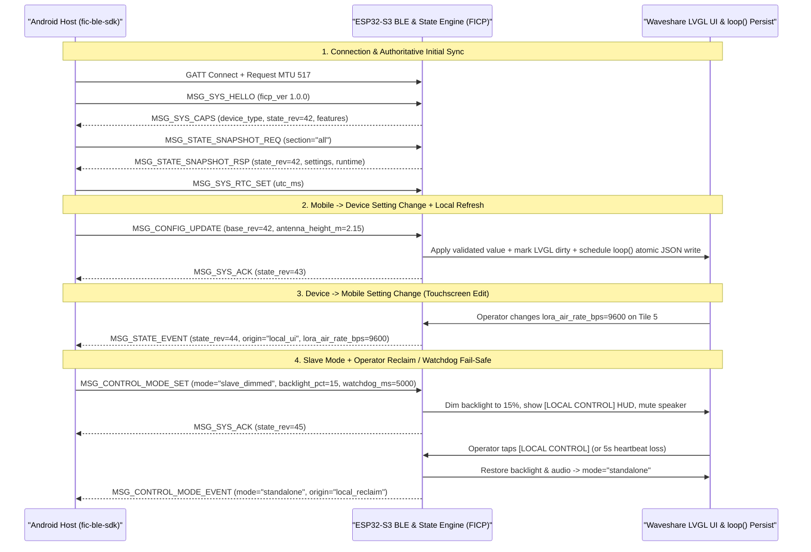

# Field Instrument Companion Protocol (FICP)

> [!NOTE]
> **Specification Version:** `1.0.0` (Status: Implemented Baseline in `Field_Instrument_Core v1.2.0+`)  
> **Last Updated:** November 25, 2026  
> **Target Hardware:** Waveshare ESP32-S3-Touch-LCD Series (`3.5B`, `3.49 v3`, and future `Field_Instrument_Core` instruments)  
> **Firmware Runtime Contract:** FreeRTOS Dual-Core + Octal PSRAM Architecture (`fic_board_types.h` / `Field_Instrument_Core`)

---

## Table of Contents
1. [Overview & Design Principles](#1-overview--design-principles)
2. [BLE 5.0 Transport & Custom FIC GATT Service](#2-ble-50-transport--custom-fic-gatt-service)
3. [FICP Wire Frame Specification (`CTRL_RX` / `CTRL_TX`)](#3-ficp-wire-frame-specification-ctrl_rx--ctrl_tx)
4. [Core Standard Message Registry (`0x00..0x7F`)](#4-core-standard-message-registry-0x000x7f)
5. [Two-Way Sync, Control Handoff & Fail-Safe Flows](#5-two-way-sync-control-handoff--fail-safe-flows)
6. [C/C++ Firmware Contract (`Field_Instrument_Core`)](#6-cc-firmware-contract-field_instrument_core)
7. [Android Reusable Client Contract (`fic-ble-sdk`)](#7-android-reusable-client-contract-fic-ble-sdk)
8. [Instrument Extension Profiles (`0x80..0xFF`)](#8-instrument-extension-profiles-0x800xff)

---

## 1. Overview & Design Principles

The **Field Instrument Companion Protocol (FICP)** defines a reusable, hardware-agnostic BLE 5.0 communication protocol between handheld Waveshare ESP32-S3 field instruments built on `Field_Instrument_Core` (`RTK_Rover`, `Magnetic_Field_Scanner`, and future instruments) and a mobile companion application (e.g., Android Jetpack Compose client).

Every instrument built with `Field_Instrument_Core` pairs an onboard QSPI touchscreen, audio feedback codec, sensors, and SD storage with an optional mobile host that adds sunlight-scale mapping, offline GIS/parcel views, cellular data backhaul (e.g., NTRIP RTCM3), voice TTS, and ergonomic keyboard input. FICP standardizes the common companion backbone so new instruments inherit bidirectional synchronization, remote hardware control, file transfer, and high-rate binary streaming without reinventing custom BLE framing.

### Core Engineering Principles
1. **100% Standalone Guarantee:** Every field instrument MUST boot and execute all primary measurement, logging, UI, and audio workflows without a mobile device present. BLE companion connectivity is strictly additive.
2. **Device-Authoritative State & Bidirectional Reflection:** The physical instrument is the authoritative owner of its persisted `settings.json`, sensor calibration, hardware limits, and active recording locks. Remote updates (`MSG_CONFIG_UPDATE`) are validated on the ESP32-S3, reflected immediately in LVGL widgets, persisted atomically via `fic_json_write_atomic()`, and confirmed with a monotonic `state_rev`. Conversely, any local touchscreen or button change pushes `MSG_STATE_EVENT` immediately so the mobile UI never drifts out of sync.
3. **Graceful Master-Slave Control Handoff & Link-Loss Fail-Safe:** The instrument supports standalone, mirrored companion, and dimmed slave operation (`MSG_CONTROL_MODE_SET`) with a one-tap physical `[LOCAL CONTROL]` reclaim button and a `5 s` heartbeat watchdog that automatically restores full local display brightness, local audio, and standalone control if the BLE link drops.
4. **ESP32-S3 `DRAM0` & Radio Mutual-Exclusion Discipline:** Because Arduino-ESP32 `v3.3.x` prebuilds NimBLE and Wi-Fi HTTP stacks using scarce internal `DRAM0`, `Field_Instrument_Core` enforces **strict BLE <-> `fic_web_portal` (Wi-Fi) mutual exclusion** and allocates all FICP RX/TX/reassembly ring buffers (`>= 1 KB`) strictly in **Octal PSRAM**.
5. **Channel Isolation for Deterministic Framing:** High-rate external binary streams (such as NTRIP `RTCM3` `0xD3` frames) travel on a dedicated GATT stream characteristic (`STREAM_RX` / `STREAM_TX`) rather than multiplexing raw external bytes onto the `CTRL_RX` command channel.

---

## 2. BLE 5.0 Transport & Custom FIC GATT Service

### 2.1 Advertising & Discovery
* **GAP Local Name:** Instrument-configured human-readable device name (`<device_prefix>` or user suffix, e.g., `"RTK-Rover"`, `"MFS-Scanner"`).
* **Primary Advertised Service UUID:** `5f494350-0001-4b10-a8e1-464943500001` (ASCII `"_ICP...FICP"` anchor).
* **MTU Target:** Peripheral configures NimBLE ATT MTU up to `517 B` (`<= 509 B` effective GATT payload per write/notify after the `3 B` ATT header and NimBLE framing overhead). Mobile central SHOULD request `MTU 517` immediately upon GATT connection, before exchanging `MSG_SYS_HELLO`.

### 2.2 Custom FIC Companion GATT Service Layout

| Role | UUID | Properties | Max Frame / Chunk | Purpose |
| :--- | :--- | :--- | :--- | :--- |
| **Service (`FIC_SVC`)** | `5f494350-0001-4b10-a8e1-464943500001` | Primary Service | -- | Unified companion service across all `Field_Instrument_Core` devices |
| **`CTRL_RX`** | `5f494350-0002-4b10-a8e1-464943500001` | Write, Write No Response | `<= 509 B` write (`<= 1035 B` FICP frame via BLE write/reassembly) | Mobile -> Device framed `0xAA 0x55` FICP commands, settings updates, heartbeats, and upload file chunks |
| **`CTRL_TX`** | `5f494350-0003-4b10-a8e1-464943500001` | Notify | `<= 509 B` single-notify target | Device -> Mobile framed `0xAA 0x55` `ACK/NACK`, snapshots, `EVT_STATE_CHANGED`, packed telemetry, and download chunks |
| **`STREAM_RX`** *(Optional)* | `5f494350-0004-4b10-a8e1-464943500001` | Write No Response | `<= 509 B` raw chunk | Mobile -> Device raw high-rate binary pass-through (e.g., NTRIP `RTCM3` `0xD3` frames to Rover `rtcm_arbiter`) |
| **`STREAM_TX`** *(Optional)* | `5f494350-0005-4b10-a8e1-464943500001` | Notify | `<= 509 B` raw chunk | Device -> Mobile raw high-rate binary pass-through (reserved for future waveform/spectrum burst streams) |

* **Why Dual Pipes (`CTRL` vs. `STREAM`):** Isolating NTRIP `RTCM3` (`0xD3`) onto `STREAM_RX` prevents RF packet loss or cellular socket framing jitter inside an NTRIP stream from corrupting or delaying `0xAA 0x55` control RPCs and `MSG_CONFIG_UPDATE` responses on `CTRL_RX`.

### 2.3 Security & Access Control Modes
`MSG_SYS_CAPS` declares the active `auth_mode` so deployments can tighten access control without changing wire framing:
* **`AUTH_MODE_OPEN_GATED` (`0x00`, Baseline Field Default):** Unbonded BLE ("Just Works") without SMP pairing keys, eliminating cross-vendor Android/NimBLE bonding cache failures in field conditions. Access is hardware-gated via the instrument's physical Quick Settings `BLE ON/OFF` toggle (and optional local touchscreen `[ALLOW]` confirmation modal on first peer connect).
* **`AUTH_MODE_SMP_BONDED` (`0x01`, Reserved):** Standard BLE 5.0 LE Secure Connections bonding / numeric passkey.
* **`AUTH_MODE_SESSION_TOKEN` (`0x02`, Reserved):** Application-layer HMAC/challenge handshake inside `MSG_SYS_HELLO` -> `MSG_SYS_CAPS`.

### 2.4 FreeRTOS Core Assignment, PSRAM & Radio Mutual Exclusion
All `Field_Instrument_Core` devices execute BLE companion services strictly inside the Core RTOS contract (`fic_board_types.h`):
* **Core `0` (`FIC_CORE_ACQ`):** Hosts NimBLE controller/host tasks, `CTRL_RX` frame ingestion, and `STREAM_RX` callback dispatch (e.g., feeding `rtcm_arbiter` without blocking Core 1 UI rendering).
* **Core `1` (`FIC_CORE_UI`):**
  * Priority `4` (`FIC_PRIO_AUDIO`): Real-time ES8311 I2S audio (respecting local mute when `local_audio == "muted"`).
  * Priority `3` (`FIC_PRIO_LVGL`): LVGL widget updates scheduled cleanly under `fic_lvgl_lock()` or thread-safe staging queues.
  * Priority `2` (`FIC_PRIO_UI_FEED`): Instrument sensor/UI feed task updating runtime telemetry snapshots.
  * Priority `1` (`FIC_PRIO_BACKGROUND`): Arduino `loop()` drains debounced configuration changes (`fic_json_write_atomic()`), chunked SD file I/O (`fs_mux`), and non-time-critical `CTRL_TX` file notifications -- **never write Flash (`FFat`) or SD inside NimBLE callbacks or LVGL tasks**.
* **PSRAM Buffering:** RX reassembly (`>= 2048 B`), TX framing staging (`>= 2048 B`), and optional `STREAM_RX` staging rings (`>= 4096 B`) MUST use `heap_caps_malloc(..., MALLOC_CAP_SPIRAM | MALLOC_CAP_8BIT)`.
* **BLE <-> `fic_web_portal` (Wi-Fi) Mutual Exclusion:** Active BLE companion mode and `fic_web_portal` HTTP/Wi-Fi are mutually exclusive at runtime. Starting `fic_web_portal_start()` cleanly notifies/disconnects any BLE peer and deinitializes NimBLE (`fic_ble_companion_stop()`) before bringing up Wi-Fi (`reclaiming ~35-55 KB` internal `DRAM0`). Calling `fic_web_portal_stop()` automatically restarts BLE companion mode when configured enabled.

---

## 3. FICP Wire Frame Specification (`CTRL_RX` / `CTRL_TX`)

Every frame sent over `CTRL_RX` or `CTRL_TX` uses an `11-byte` Little-Endian framing envelope around `0..1024 B` of payload (`11 + N` total bytes):

| Byte Offset | Size | Field | Type | Description |
| :--- | :--- | :--- | :--- | :--- |
| `0..1` | `2 B` | `sync` | `uint8_t[2]` | Fixed synchronization preamble `0xAA, 0x55` |
| `2` | `1 B` | `ver` | `uint8_t` | Protocol version (`0x01` for `FICP v1.0.0`) |
| `3` | `1 B` | `msg_id` | `uint8_t` | Message identifier (`0x00..0x7F` Core, `0x80..0xFF` Instrument extension) |
| `4` | `1 B` | `flags` | `uint8_t` | Bitmask: `bit 0 = FLAG_ACK_REQ`, `bit 1 = FLAG_IS_JSON`, `bit 2 = FLAG_FRAGMENT`, `bits 3..7 = 0` |
| `5..6` | `2 B` | `seq` | `uint16_t` LE | Monotonic sender sequence number (`1..65535`, wraps skipping `0` optional) |
| `7..8` | `2 B` | `payload_len` | `uint16_t` LE | Payload byte length `N` (`0 <= N <= 1024`) |
| `9..(9+N-1)` | `N B` | `payload` | `uint8_t[N]` | Payload bytes (UTF-8 compact JSON if `FLAG_IS_JSON=1`; packed LE struct if `0`) |
| `(9+N)..(10+N)` | `2 B` | `crc16` | `uint16_t` LE | `CRC-16/CCITT-FALSE` (`poly = 0x1021`, `init = 0xFFFF`, no final XOR) computed over bytes `2..(9+N-1)` (`ver` through end of `payload`) |

### Frame Validation & Reassembly Rules
1. **Receiver State Machine:** Scans for `[0xAA, 0x55]`, reads `ver`, `msg_id`, `flags`, `seq`, `payload_len`. If `ver != 0x01` or `payload_len > 1024`, immediately reset parser state and search for the next `0xAA 0x55` (never buffer unbounded lengths).
2. **CRC Check:** Frames failing `crc16` verification are discarded cleanly; if header fields appeared plausible and `FLAG_ACK_REQ` was set, the receiver MAY emit `MSG_SYS_NACK` (`ERR_BAD_CRC`), incrementing diagnostics error counters.
3. **Single-Notify Preferred Target:** Telemetry, heartbeats, events, ACKs, and typical `MSG_CONFIG_UPDATE` messages MUST stay `<= 509 B` so each fits cleanly inside a single `MTU 517` BLE packet. Larger JSON snapshots (`MSG_STATE_SNAPSHOT_RSP`) may either send across two back-to-back GATT writes/notifications (`payload_len <= 1024`) reassembled by the receiver ring buffer or paginate by domain section (`section: "settings" | "runtime"`).

### Payload Encoding Policy
* **Compact JSON (`FLAG_IS_JSON = 1`):** Used for `MSG_SYS_HELLO`, `MSG_SYS_CAPS`, `MSG_SYS_ACK`, `MSG_SYS_NACK`, `MSG_SYS_HEALTH_RSP`, `MSG_STATE_SNAPSHOT_REQ/RSP`, `MSG_CONFIG_UPDATE`, `MSG_STATE_EVENT`, `MSG_CONTROL_MODE_*`, and `MSG_FILE_LIST_*`. Reuses the exact `settings.json` keys handled by `ArduinoJson v7` on the firmware side, avoiding fragile numeric parameter lookup tables across future instruments.
* **Packed Little-Endian Binary (`FLAG_IS_JSON = 0`):** Used strictly for `MSG_SYS_HEARTBEAT`, `MSG_FILE_CHUNK`, and high-rate (`5-20 Hz`) instrument telemetry (`0x81`, e.g., Rover WGS84 64-bit `double` tip/base coordinates).

---

## 4. Core Standard Message Registry (`0x00..0x7F`)

### 4.1 Registry Overview

| `msg_id` | Symbol | Direction | Format | Meaning |
| :--- | :--- | :--- | :--- | :--- |
| `0x01` | `MSG_SYS_HELLO` | Mobile -> Device | JSON | Client opens session (`client_name`, `client_ver`, `ficp_ver`, `utc_ms`) |
| `0x02` | `MSG_SYS_CAPS` | Device -> Mobile | JSON | Device capability manifest, hardware profile, `state_rev`, `auth_mode`, feature flags |
| `0x03` | `MSG_SYS_HEARTBEAT` | Both | Binary (`8 B`) | Keep-alive (`uint32_t uptime_ms`, `uint16_t state_rev_lo16`, `uint8_t control_mode`, `uint8_t flags`) every `1000 ms` |
| `0x04` | `MSG_SYS_ACK` | Both | JSON | Positive acknowledgment (`ack_seq`, `state_rev`, optional `data` object) |
| `0x05` | `MSG_SYS_NACK` | Both | JSON | Rejection (`ack_seq`, `err_code`, `reason`, current `state_rev`) |
| `0x06` | `MSG_SYS_HEALTH_REQ` | Mobile -> Device | Binary (`0 B`) | Request heap, PSRAM, battery (`AXP2101`), I2C, and SD diagnostics |
| `0x07` | `MSG_SYS_HEALTH_RSP` | Device -> Mobile | JSON | Returns `dram_free`, `dram_largest`, `psram_free`, `vbat_mv`, `batt_pct`, `i2c0_errs`, `i2c1_errs`, `sd_ok`, `uptime_s` |
| `0x08` | `MSG_SYS_RTC_SET` | Mobile -> Device | Binary (`8 B`) | Sync phone UTC epoch (`int64_t unix_utc_ms` or split calendar) -> updates `PCF85063` RTC |
| `0x09` | `MSG_SYS_SCREENSHOT_REQ` | Mobile -> Device | Binary (`0 B`) | Trigger lock-free `fic_screenshot_save_bmp()`, reply `MSG_SYS_ACK` with saved path |
| `0x10` | `MSG_STATE_SNAPSHOT_REQ` | Mobile -> Device | JSON | Request full authoritative `settings` + `runtime` snapshot (`{"section":"all"}` or `"settings"`/`"runtime"`) |
| `0x11` | `MSG_STATE_SNAPSHOT_RSP` | Device -> Mobile | JSON | Returns full snapshot with `state_rev`, `schema_ver`, `settings{}`, and `runtime{}` |
| `0x12` | `MSG_CONFIG_UPDATE` | Mobile -> Device | JSON | Apply validated subset of configuration/setting keys (`base_rev`, `persist`, `settings{}`) |
| `0x13` | `MSG_STATE_EVENT` | Device -> Mobile | JSON | Unsolicited push whenever local UI/hardware changes settings or runtime state (`state_rev`, `origin`, `settings{}`, `runtime{}`) |
| `0x20` | `MSG_CONTROL_MODE_SET` | Mobile -> Device | JSON | Request `standalone`, `companion_mirror`, or `slave_dimmed` control state (`backlight_pct`, `local_audio`, `watchdog_ms`) |
| `0x21` | `MSG_CONTROL_MODE_EVENT` | Device -> Mobile | JSON | Immediate push when control state changes (`origin`: `"remote"`, `"local_reclaim"`, `"watchdog_timeout"`, `"radio_switch"`) |
| `0x30` | `MSG_FILE_LIST_REQ` | Mobile -> Device | JSON | List directory on active storage (`fs`: `"sd" \| "ffat"`, `path`, `offset`, `limit`) |
| `0x31` | `MSG_FILE_LIST_RSP` | Device -> Mobile | JSON | Paginated directory entries (`name`, `size`, `is_dir`) + `has_more` |
| `0x32` | `MSG_FILE_OPEN_REQ` | Mobile -> Device | JSON | Open file for read or atomic upload (`op`: `"read" \| "write"`, `fs`, `path`, `total_bytes`, `crc32`) |
| `0x33` | `MSG_FILE_CHUNK` | Both | Binary | `uint16_t handle`, `uint32_t offset`, `uint8_t raw[<=480]` |
| `0x34` | `MSG_FILE_CLOSE_REQ` | Mobile -> Device | JSON | Commit uploaded `.tmp` (verify `total_bytes` + `crc32` + atomic `rename()`) or close/abort read handle |
| `0x80..0xFF` | Instrument Extensions | Both | Binary / JSON | Reserved per `device_type` (see [Section 8](#8-instrument-extension-profiles-0x800xff)) |

### 4.2 Canonical `MSG_SYS_NACK` Error Codes

| Code | Name | Meaning |
| :--- | :--- | :--- |
| `1` | `ERR_BAD_CRC` | Frame checksum or structural framing mismatch |
| `2` | `ERR_UNSUPPORTED_MSG` | Unknown `msg_id` or unsupported optional feature (`STREAM_RX` absent, etc.) |
| `3` | `ERR_INVALID_PARAM` | JSON parse failure, missing key, or value outside device safety range |
| `4` | `ERR_REV_CONFLICT` | Optional strict `base_rev` conflict; device includes authoritative `state_rev` in NACK so mobile re-snapshots |
| `5` | `ERR_BUSY_LOCKED` | Device state locked by active field operation (e.g., file write/delete during active recording or survey averaging) |
| `6` | `ERR_STORAGE_FAIL` | SD/FFat mount missing, size/CRC32 verification failure on upload, or atomic rename failure |
| `7` | `ERR_UNAUTHORIZED` | Peer rejected by local user consent gate or `auth_mode` restriction |

### 4.3 Handshake & State Schema Details

**`MSG_SYS_HELLO` (`0x01`, Mobile -> Device):**
```json
{"client_name":"RTK-Rover-Mobile","client_ver":"1.0.0","ficp_ver":"1.0.0","utc_ms":1764075000000}
```

**`MSG_SYS_CAPS` (`0x02`, Device -> Mobile):**
```json
{
  "ficp_ver": "1.0.0",
  "device_type": "rtk_rover",
  "device_name": "RTK-Rover",
  "fw_ver": "v0.12.0",
  "core_ver": "v1.2.0",
  "board": "waveshare_s3_35b",
  "auth_mode": 0,
  "state_rev": 42,
  "control_mode": "standalone",
  "mtu_max": 517,
  "telem_hz_max": 10,
  "features": ["settings_sync", "control_handoff", "file_sync", "stream_rx", "rtc_sync", "screenshot"]
}
```

**`MSG_STATE_SNAPSHOT_RSP` (`0x11`, Device -> Mobile):**
```json
{
  "state_rev": 42,
  "schema_ver": 2,
  "settings": {
    "antenna_spacing_m": 1.00,
    "antenna_height_m": 2.00,
    "rtcm_source_mode": "AUTO",
    "lora_air_rate_bps": 4800
  },
  "runtime": {
    "control_mode": "standalone",
    "backlight_pct": 85,
    "local_audio": "active",
    "active_tile": 0,
    "rec_active": false,
    "survey_active": false
  }
}
```

**`MSG_CONFIG_UPDATE` (`0x12`, Mobile -> Device):**
```json
{
  "base_rev": 42,
  "persist": true,
  "settings": {
    "antenna_height_m": 2.15,
    "rtcm_source_mode": "AUTO"
  }
}
```
*Rules for `MSG_CONFIG_UPDATE` Validation:*
- Firmware applies **all-or-nothing or per-key bounded clamping/rejection** as declared by the instrument handler, updates in-memory runtime structs, refreshes any visible LVGL widgets cleanly on Core 1, increments `state_rev` (`42 -> 43`), sets the debounced `settings_dirty` flag when `persist == true` (never blocking NimBLE on `FFat`/SD writes), and responds with `MSG_SYS_ACK` (`{"ack_seq": 17, "state_rev": 43, "applied": {"antenna_height_m": 2.15}}`).
- If `base_rev` mismatches an intervening local touchscreen edit on an affected key, firmware returns `MSG_SYS_NACK` (`err_code: 4`, `ERR_REV_CONFLICT`, `state_rev: 43`) so the mobile client refreshes before re-applying.

**`MSG_STATE_EVENT` (`0x13`, Device -> Mobile):**
```json
{
  "state_rev": 44,
  "origin": "local_ui",
  "settings": {
    "lora_air_rate_bps": 9600
  },
  "runtime": {
    "active_tile": 5
  }
}
```
*Rules for Local Reflection:* Whenever the user changes any mirrored setting on the Waveshare touchscreen (e.g., toggling Tile 5 settings, changing LoRa rate, switching active waypoint index, toggling `REC ON/OFF`, or resetting pole geometry via HTTP/local UI), the instrument increments `state_rev`, schedules Core 1 Priority-1 persistence, and emits `MSG_STATE_EVENT` so the mobile companion stays instantaneously synchronized.

### 4.4 Master-Slave Control Handoff (`MSG_CONTROL_MODE_SET` `0x20`)
Supported modes:
* **`standalone`:** Normal local instrument operation; companion link stays passive or telemetry-only.
* **`companion_mirror`:** Full bidirectional sync where both the Waveshare screen and mobile app operate side-by-side (`backlight_pct` remains normal, audio stays active or follows instrument setting).
* **`slave_dimmed`:** Mobile app acts as primary operator interface. Waveshare touchscreen dims (`backlight_pct` clamped `10..30%`, typically `15%`), renders a high-contrast compact Companion HUD overlay (`Fix/State + Link Status + one-tap [LOCAL CONTROL]` button), and sets `local_audio` (`"muted"` or `"follow_instrument"`).

**Link-Loss & Reclaim Safety Invariants:**
1. **`[LOCAL CONTROL]` Instant Reclaim:** Tapping `[LOCAL CONTROL]` on the Waveshare display (or pressing the board's designated physical/quick reclaim trigger) IMMEDIATELY restores full backlight, restores local audio, transitions to `standalone`, increments `state_rev`, and emits `MSG_CONTROL_MODE_EVENT` (`"origin": "local_reclaim"`). The phone MUST honor this immediately and MUST NOT forcibly re-enter `slave_dimmed` without explicit operator action.
2. **Heartbeat Watchdog (`watchdog_ms`, default `5000 ms`, allowed range `3000..15000 ms`):** Both sides send `MSG_SYS_HEARTBEAT` (`0x03`) every `1000 ms` while connected. If BLE disconnects OR no valid packet/heartbeat arrives from the mobile central within `watchdog_ms` while in `slave_dimmed`, the device autonomously reverts to `standalone` (`origin: "watchdog_timeout"`), restores backlight and audio, and preserves any in-progress recording safely on SD.

---

## 5. Two-Way Sync, Control Handoff & Fail-Safe Flows



---

## 6. C/C++ Firmware Contract (`Field_Instrument_Core`)

`Field_Instrument_Core v1.2.0` will expose the generic BLE companion engine under `src/ble/fic_ble_companion.h` so every instrument links the exact same framing, PSRAM buffers, sync ledger, and radio mutual-exclusion logic while registering only its domain callbacks.

### Planned Public Surface (`src/ble/fic_ble_companion.h`)
* **Typedefs & Callbacks:**
  * `FicControlMode_t`: `FIC_CTRL_STANDALONE = 0`, `FIC_CTRL_COMPANION_MIRROR = 1`, `FIC_CTRL_SLAVE_DIMMED = 2`.
  * `fic_ble_snapshot_cb_t`: Populates instrument `settings` + `runtime` `JsonObject`s into `MSG_STATE_SNAPSHOT_RSP`.
  * `fic_ble_config_update_cb_t`: Validates incoming `settings` `JsonObject`, applies changes to instrument state, triggers LVGL UI refresh, populates `applied` object or rejection reason.
  * `fic_ble_control_mode_cb_t`: Applies `FicControlMode_t`, `backlight_pct`, and `local_audio` state to the instrument's board display/audio drivers.
  * `fic_ble_ext_rpc_cb_t`: Dispatches instrument-specific `0x80..0xFF` control frames.
  * `fic_ble_stream_rx_cb_t`: Fast Core 0 callback receiving zero-framed raw chunks arriving on `STREAM_RX` (e.g., `rtcm_arbiter_submit()`).
  * `fic_ble_telem_pack_cb_t`: Packs `0x81` binary telemetry payload (`5-20 Hz`) when `CTRL_TX` notify is subscribed.
* **Configuration & Lifecycle Functions:**
  * `FicBleCompanionCfg_t`: Injects `device_type`, `device_name`, `fw_version`, `feature_mask`, `telem_hz_default`, PSRAM buffer sizes, `fs::FS` + `fs_mux` (for generic file transfer), `fic_log_cb_t`, and the instrument callbacks above.
  * `fic_ble_companion_configure(const FicBleCompanionCfg_t *cfg)`
  * `fic_ble_companion_start(void)` / `fic_ble_companion_stop(void)` (tears down cleanly and frees NimBLE internal `DRAM0` when switching to Wi-Fi Web Portal)
  * `fic_ble_companion_loop(void)` (called from Priority-1 `loop()` to process deferred file commits, watchdog checks, heartbeats, and queued `CTRL_TX` events safely outside NimBLE/LVGL contexts)
  * `fic_ble_companion_notify_local_change(...)` (called when local touchscreen/UI/sensor changes settings or runtime keys; increments `state_rev` and emits `MSG_STATE_EVENT`)
  * `fic_ble_companion_reclaim_local(const char *origin)` (immediate local reclaim hook for `[LOCAL CONTROL]` button)
  * `fic_ble_companion_send_ext_packet(...)` (sends packed `0x81` telemetry or `0xA0..0xBF` domain event)
* **Core Coexistence Hook (`fic_web_portal.cpp`):** `fic_web_portal_start()` queries `fic_ble_companion_is_active()` and invokes `fic_ble_companion_stop()` before calling `WiFi.mode()`, guaranteeing no simultaneous NimBLE + Wi-Fi `DRAM0` starvation in any `Field_Instrument_Core` sketch.

---

## 7. Android Reusable Client Contract (`fic-ble-sdk`)

Companion Android applications (starting with `RTK-Rover-Mobile` and future Waveshare companion apps) SHOULD separate generic FICP transport from instrument-specific screens into a clean Kotlin library module **`fic-ble-sdk`**:

* **`FicBleClient`:** Scans by Service UUID `5f494350-0001-4b10-a8e1-464943500001` (or device name prefix), maintains BLE connection + automatic `< 1.5 s` field reconnect inside an Android Foreground Service, negotiates `MTU 517`, runs the `MSG_SYS_HELLO -> MSG_SYS_CAPS -> MSG_STATE_SNAPSHOT_REQ -> MSG_SYS_RTC_SET` startup sequence, and sends `1 Hz` `MSG_SYS_HEARTBEAT` frames.
* **`FicFrameCodec`:** Pure Kotlin multi-platform encoder/decoder for `11 B` `0xAA 0x55` frames, `CRC-16/CCITT-FALSE` validation, sequential `seq` correlation, and timeout/retry ACK futures (`Result<FicAck>`).
* **`FicStateStore`:** Exposes reactive `StateFlow<FicInstrumentState>` (`caps`, `stateRev`, `settingsJson`, `runtimeJson`, `controlMode`, `health`) merged automatically on every `MSG_STATE_SNAPSHOT_RSP`, `MSG_SYS_ACK`, `MSG_STATE_EVENT`, and `MSG_CONTROL_MODE_EVENT`. If `stateRev` skips an integer, `FicStateStore` automatically triggers `MSG_STATE_SNAPSHOT_REQ` to recover zero-loss consistency.
* **`FicFileTransferClient`:** Implements `listFiles()`, `downloadFile()`, and `uploadFile()` (computing CRC32 and streaming `MSG_FILE_OPEN_REQ` / `MSG_FILE_CHUNK` / `MSG_FILE_CLOSE_REQ`).
* **`FicStreamChannel`:** High-throughput asynchronous writer pushing raw binary frames (e.g., NTRIP `RTCM3`) to `STREAM_RX` without blocking control RPCs.

---

## 8. Instrument Extension Profiles (`0x80..0xFF`)

Each `Field_Instrument_Core` instrument registers its own `device_type` profile on top of Core messages `0x00..0x7F`:

### 8.1 `RTK_Rover` (`device_type = "rtk_rover"`, `stream_rx = enabled`)
* **`STREAM_RX`:** Raw NTRIP `RTCM3` (`0xD3`) pass-through directly into Rover Core 0 `rtcm_arbiter_submit(RTCM_SRC_BLE_NTRIP, ...)`.
* **`0x81` (`MSG_ROVER_TELEM`, Device -> Mobile, `5-10 Hz`):** Packed Little-Endian binary payload (`~96 B`, single `CTRL_TX` notify) carrying 64-bit `double` Ground-Tip WGS84 `(lat, lon)`, 64-bit `double` `BASEINFOA` Base Station `(lat, lon, base_id)`, MSL elevation + `BMP581` delta + undulation, ANT1/ANT2 fix & heading source (`HDG_SRC_*`), `SEN0696`/`QMI8658` pitch/roll/mag flags, `h_rms`/`v_rms`/`diff_age`, E220 RSSI/noise/rate/RTCM source, `AXP2101` battery, active waypoint index, survey countdown, and SD/REC flags.
* **Domain RPCs (`0x82..0x8B`):**
  * `0x82` `CMD_ROVER_SET_TARGET_POINT` (push ad-hoc stakeout vertex onto `ActiveGuidanceSegment_t` / Tile 0)
  * `0x83` `CMD_ROVER_SET_LINE_STAKEOUT` (push `A -> B` deed line onto `ActiveGuidanceSegment_t` / Tile 0)
  * `0x84` `CMD_ROVER_SELECT_WAYPOINT` (sync active Tile 2 CSV index / filename)
  * `0x85` `CMD_ROVER_SURVEY_LOG` (start/abort multi-epoch monument pin averaging; progress/completion emitted via `0xA1` `EVT_ROVER_SURVEY_RESULT`)
  * `0x86` `CMD_ROVER_ROUTE_REC_SET` (toggle `1 Hz` `route_*.csv` recording)
  * `0x87` `CMD_ROVER_RADIO_SET_RATE` (trigger native `4.8k / 9.6k / 19.2k` E220 rate switch)
  * `0x88` `CMD_ROVER_RTCM_SET_MODE` (switch `rtcm_arbiter`: `AUTO / LORA_ONLY / NTRIP_ONLY`)
  * `0x89` `CMD_ROVER_SENSOR_CAL` (`TARE` pole level or `Tile 3` `CAL MAG`)
  * `0x8A` `CMD_ROVER_POLE_GEOM_SET` (atomic pole spacing/height/threshold update, or handled cleanly via standard `MSG_CONFIG_UPDATE`)
* **Bidirectional Settings via FICP `0x10..0x13`:** Pole geometry, NTRIP caster profile (`ntrip_host`, `ntrip_port`, `ntrip_mountpoint`, `ntrip_user_email`), `rtcm_source_mode`, `lora_air_rate_bps`, `line_log_max_m`, `line_audio_fade_m`, and `apply_lever_arm_on_calibrated_beam` sync cleanly both ways using standard `MSG_STATE_SNAPSHOT_RSP`, `MSG_CONFIG_UPDATE`, and `MSG_STATE_EVENT` -- and file uploads (`waypoints.csv`, parcel files) use standard FICP `0x30..0x34`.

### 8.2 `Magnetic_Field_Scanner` (`device_type = "mag_scanner"`, Planned Future Profile)
* **Standard Core Features Inherited Automatically (`0 B` custom BLE glue):** Two-way sensitivity/threshold/audio/sample-rate sync (`0x10..0x13`), dimmed slave HUD (`0x20..0x21`), SD scan CSV download (`0x30..0x34`), RTC clock sync (`0x08`), and health monitoring (`0x06..0x07`).
* **Planned Extensions (`0x80..0xFF`):** `0x81` binary gradient/vector/magnitude/AHRS stream (`10-20 Hz`), `0x82` start/stop CSV scan logging, `0x83` zero/tare baseline offset, and `0x84` `RM3100` calibration state control.
